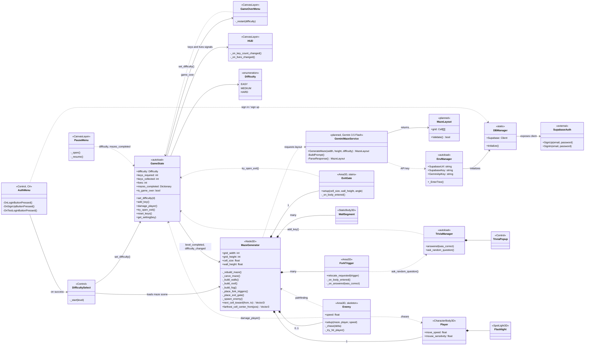
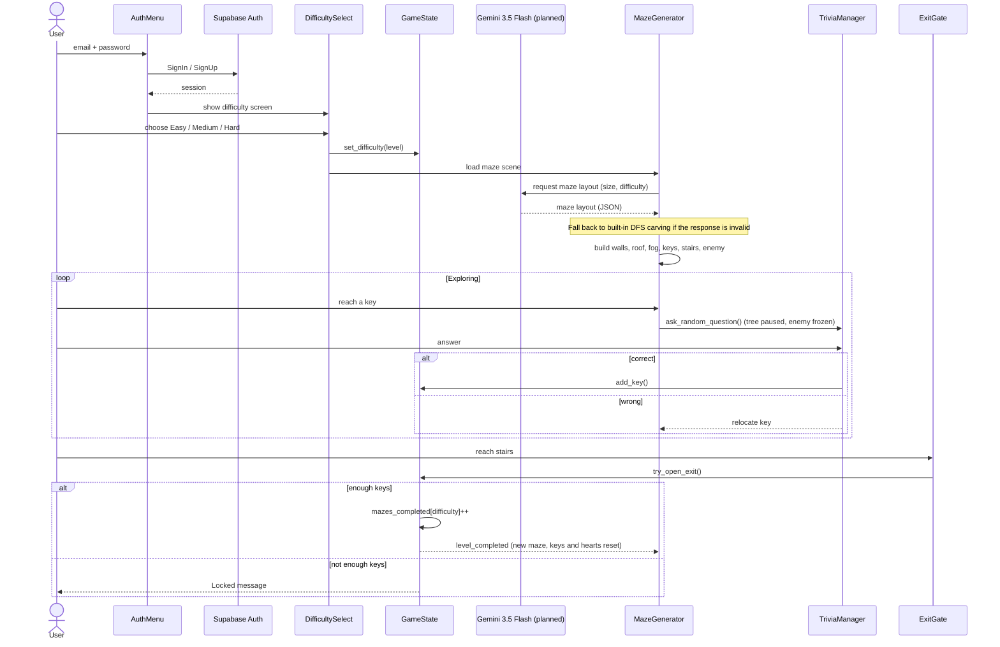
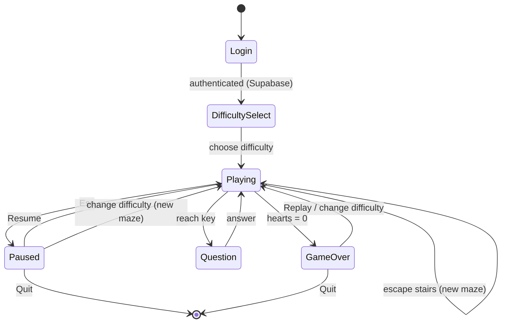

# AI Labyrinth – UML

Diagrams use [Mermaid](https://mermaid.js.org/) (renders on GitHub and in VS Code's Markdown preview).
Elements marked "planned" are not implemented yet (Gemini maze generation).

## Class diagram

## Sequence: login, play, escape

## State: game flow

